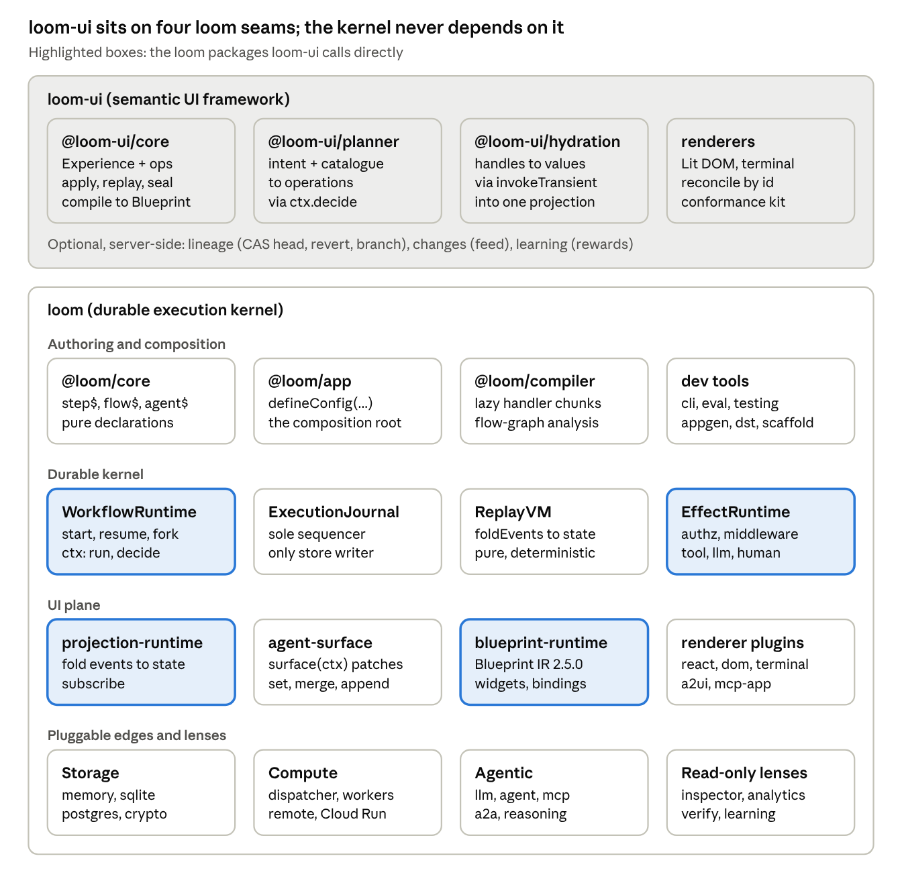
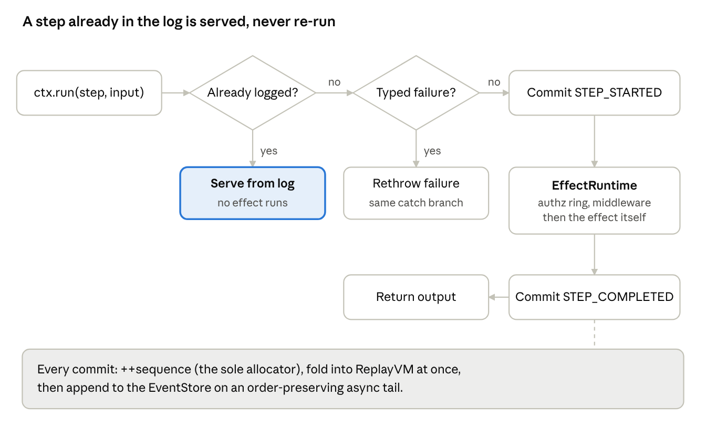
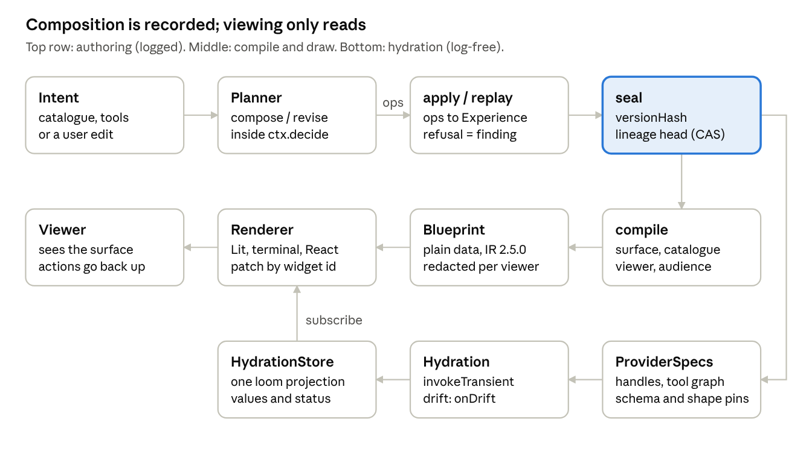

# Loom & loom-ui — Architecture and Codebase Guide

As of 2026-10-24. A guide to both repositories: how they are built, where to start reading, and how
data and control flow through them. It is mirrored in `loom/docs/codebase-guide.md` and
`loom-ui/docs/codebase-guide.md`; paths are relative to the repo they name.

## Contents

1. [Overview](#1-overview)
2. [Architecture](#2-architecture)
3. [loom codebase guide](#3-loom-codebase-guide)
4. [loom-ui codebase guide](#4-loom-ui-codebase-guide)
5. [Data, information and control flow](#5-data-information-and-control-flow)
6. [Build, test and dev workflow](#6-build-test-and-dev-workflow)
7. [Suggested reading order and glossary](#7-suggested-reading-order-and-glossary)

## 1. Overview

**Loom** is a durable execution kernel for agentic, human-in-the-loop software: every meaningful moment of a run is an event in an append-only log, and state is always `fold(events)`. **loom-ui** is a semantic UI framework on top of it: you describe an *Experience* (a tree of semantic nodes bound to data handles), and loom-ui compiles it to loom's `Blueprint`, which loom's renderers draw.

The one idea to hold while reading either repo: **the log is the source of truth, and everything else is a lens on it.** Resume, replay, fork, eval, time-travel debugging, projections and UI are all different ways of folding or re-reading the same recorded facts. loom-ui applies the same idea to UI: an Experience is a content-addressed artifact plus the operations that produced it, so a view can be replayed and revised without losing node identity.

| | loom | loom-ui |
| --- | --- | --- |
| Path | `~/workspace/loom` | `~/workspace/loom-ui` |
| What it is | Kernel + first-party packages, plugins, dev tools | Experience Model, compiler to Blueprint, hydration, planner, renderers |
| Size | ~72 workspace packages, ~1,450 source files | 9 packages, ~500 source files |
| Package scopes | `@loom/*` (`packages/`, `plugins/`, `tools/`, `apps/`) | `@loom-ui/*` (`packages/`) |
| Build | pnpm 9.14.4 + turbo, TypeScript, CommonJS | pnpm 9.14.4, `pnpm -r`, CommonJS (renderer-lit is ESM) |
| Lint / test | biome, vitest | biome, vitest (renderer-lit under happy-dom) |
| Orientation files | `AGENTS.md`, `README.org`, `docs/architecture.md`, `docs/adr/` (133 ADRs) | `AGENTS.md`, `README.md`, `docs/guides/`, `docs/reference/` |

### How the repos relate

loom-ui depends on loom, never the reverse. loom is an unpublished monorepo, so loom-ui's `package.json` redirects every `@loom/*` dependency through `pnpm.overrides` to `link:../loom/packages/<name>` (or `../loom/plugins/<name>`). That means:

- `../loom` must be checked out beside `loom-ui`, installed and **built** (`pnpm install && pnpm build`) before anything in loom-ui resolves.
- loom-ui tests and typechecks read loom's built `dist` and `.d.ts`. Edit loom, rebuild loom, then test loom-ui.
- loom-ui CI pins loom to a commit (`LOOM_REF` in `.github/workflows/ci.yml`); bump it in the same PR that adapts to a loom change.

Other siblings in `~/workspace` follow the same `link:` pattern: `loom-examples` (all runnable example apps, extracted out of loom), `loom-plugins` (third-party plugins), `loom-demo`, `loom-site` (Astro docs), and the consumer apps built on them.

The loom-ui design document lives in loom, not loom-ui: `loom/docs/requirements/2026-09-21-loom-ui-design.md`.

## 2. Architecture

loom is three concentric rings: what you **author** (plain TypeScript), the **durable core** that records and replays it, and **pluggable edges** for storage, compute, models and rendering. loom-ui is a client of that stack: it touches loom at four seams and nothing in loom imports it back.



Read top to bottom: loom-ui composes and compiles; loom executes, records and renders. The four highlighted seams are the whole contract between the repos: `blueprint-runtime` (compile target), `projection-runtime` (where hydrated values live), `EffectRuntime.invokeTransient` (how hydration calls tools without touching the log) and `ctx.decide` on the workflow runtime (how the planner's model call becomes a recorded decision).

### loom's design principles, in brief

These come from `loom/docs/architecture.md` section 2; almost every odd-looking line of kernel code traces back to one.

| Principle | What it means in code |
| --- | --- |
| P1 The log is the source of truth | State is never stored; it is `foldEvents(events)`. |
| P2 Replay is pure | No `Date.now()` or `Math.random()` on reproducible paths; folds have no side effects. |
| P3 Suspension is normal | `ctx.suspend()` writes a checkpoint and returns; `resume()` continues from it. |
| P4 Plain code, no DSL | A flow is `async (ctx, input) => ...` calling `ctx.run`, `ctx.suspend`, `ctx.parallel`. |
| P5 Static wiring | Flows and effects are registered from explicit imports (or build-time codegen), never runtime globbing, so a replay or remote worker rebuilds the same set. |
| P6 Composition over inheritance | Helpers are functions over the same primitives; you can always drop a layer. |
| P7 Pure cores, thin edges | Logic is a pure fold, format, plan or codegen wrapped by a thin I/O shell. |
| P8 Isomorphic core | Storage, compute, models and renderers are interfaces with adapters. |
| P9 Logged non-determinism | Model routing, learning and other choices go through `ctx.decide` and become `DECISION_RECORDED` facts. |
| P10 Minimal kernel | Everything smart is an opt-in advisory module; an unwired ring is byte-identical to no ring. |
| P11 NL compiles to code | `@loom/appgen` turns intent into ordinary source at build time, never at runtime. |

### Kernel hardening rings

The kernel exposes a versioned syscall ABI (K1: `execute`, `run`, `decide`, `parallel`, `suspend`, `sleep`, `receive`, `select`, `continueAsNew`, `emit`, `stream`) and a set of opt-in rings, each of which logs its verdict as an ordinary event: authority K2 (`EFFECT_DENIED`), quotas K3, fault supervision K4, event-schema governance K5, safety K6, isolation and egress K7, cancellation and deadlines K8, delivery and fencing K9, log lifecycle and crypto-shredding K10, flow-code versioning K11, identity and tenancy K12, durable timers T1 and the wire ABI T2.

### loom-ui's design in one paragraph

loom-ui keeps the same discipline for UI. An Experience is data; every change is an `Operation`; `replay` folds operations deterministically and `seal` content-addresses the result. Model calls happen only in the planner, inside `ctx.decide`. Hydration is read-only and uses transient effects, so viewing a dashboard never writes to the durable log. Rendering is downstream of a plain-data `Blueprint`, so any renderer that passes the conformance kit can draw it.

## 3. loom codebase guide

Start in five files: `packages/core/src/builders/step.ts` and `flow.ts` (what you author), `packages/workflow-runtime/src/WorkflowContext.ts` (what `ctx.run` does), `packages/workflow-runtime/src/ExecutionJournal.ts` (how events get written) and `packages/replay-vm/src/foldEvents.ts` (how state is derived). Everything else in the repo is a ring, an adapter or a lens around those.

Line numbers below are approximate (as of loom `b0cb9461`); search for the symbol if they have moved.

### Top-level layout

| Path | What lives there |
| --- | --- |
| `packages/` | The kernel (mechanism and ABI), SPI-contract packages, and optional advisory modules. ~43 packages. |
| `plugins/` | First-party adapters for a specific external system, published as `@loom/plugin-*` (SQLite, Postgres, MCP, A2A, renderers, crypto, workers). A CI layering guard forbids any kernel package from depending on a plugin. |
| `tools/` | Dev-time leaf packages: `cli`, `compiler`, `appgen`, `eval`, `testing`, `dst`, `deploy-sim`, `scaffold`, `create-loom-app`. Never imported by runtime code. |
| `apps/playground` | A development playground. |
| `docs/` | `architecture.md` (start here), `adr/` (133 ADRs), `api-reference.org`, `loom-2.0/`, `requirements/` (design docs, including loom-ui's), `user-guide/`. |
| `evals/` | loom's own eval suite with baselines (`pnpm eval`). |
| Root config | `turbo.json`, `tsconfig.base.json`, `vitest.shared.ts` (the one vitest config), `biome.json`, `pnpm-workspace.yaml`. |

### The kernel, package by package

| Package | Read first | Role |
| --- | --- | --- |
| `@loom/core` | `src/builders/*.ts`, `src/types/definitions.ts`, `src/types/execution.ts` | Authoring builders (`step$`, `flow$`, `tool$`, `agent$`, `projection$`, `schedule$`, `policy$`, `skill$`, `memory$`) and shared types. Pure declarations, no runtime. Also `flowHash.ts` (the `flowContentHash` that pins in-flight executions to code). |
| `@loom/workflow-runtime` | `src/WorkflowRuntime.ts` (`start` ~L3552, `resume` ~L3840, `resumeAs` ~L7175, `loadState` ~L7463, `fork` ~L7743, private `execute` ~L8786) | Drives executions: bootstraps, authorizes, builds the journal and context, runs the flow, handles suspend, cancel, deadlines, leases, inbox and continue-as-new. 9,600 lines; read by method, not top to bottom. |
| | `src/WorkflowContext.ts` (`execute` L754, `run` L1134, `decide` L1142, `parallel` L1324, `suspend` L1763, `continueAsNew` L1806, `receive`/`select` L1869, `sleep` L2404) | The syscall surface a flow sees as `ctx`. Each call is either served from the log or executed live and journaled. |
| | `src/ExecutionJournal.ts` | The single sequence allocator and the only caller of `eventStore.append`. Folds synchronously, writes asynchronously on a FIFO tail. |
| | `src/abi.ts`, `src/types.ts` | `KERNEL_ABI` (the versioned syscall ABI, K1) and the runtime's public types (`RegisteredFlow`, `FlowRunner`, `RunOptions`, `ExecutionHandle`). |
| | `TimerService.ts`, `inbox.ts`, `leaseKeeper.ts`, `driverLease.ts`, `LogLifecycle.ts`, `recoverAbandoned.ts` | Durable timers (T1), inbox messaging, driver leases and fencing (K9), retention and shredding (K10), crash recovery. |
| `@loom/replay-vm` | `src/foldEvents.ts`, `src/ReplayVM.ts`, `src/eventHandlers.ts` | Pure fold: one handler per event type, `(state, event) => state`, copy-on-write. `ReplayVM` wraps a fold you can keep applying events to and query (`hasCompleted`, `getOutput`, `getTypedFailure`). |
| `@loom/event-runtime` | `src/types.ts` | The `EventStore` SPI plus in-memory, sharded, tenant-scoped and coalescing stores, `BranchRegistry` (git-style refs for forks), leases, timers. |
| `@loom/snapshot-runtime` | `src/` | `SnapshotStore` SPI: checkpoints so a resume folds only the tail. |
| `@loom/effect-runtime` | `src/EffectRuntime.ts` (`execute` L60), `authz.ts`, `policy.ts`, `effects/*` | The side-effect boundary keyed by `toolId`. Authorizer first (K2, `EFFECT_DENIED`), then the middleware chain (`middleware[0]` outermost), then the effect (`ToolEffect`, `LlmEffect`, `HumanEffect`, `LazyEffect`). |
| `@loom/middleware` | `src/` | Reference middleware: retry, metering (K3), safety (K6), redaction (K10), claim-check (large results stored by reference). |
| `@loom/app` | `src/defineConfig.ts` (`LoomConfig` L1083, `LoomApp` L1435, `defineConfig` L1880) | The composition root. Turns one static config into a wired `WorkflowRuntime`, `EffectRuntime`, `ProjectionRuntime`, stores, A2A bus, timers, memory and schedules. |
| `@loom/sdk` | `src/index.ts` | The public re-export barrel. |

### Around the kernel

- **UI and projections.** `@loom/projection-runtime` (`src/types.ts`: `Projection`, `ProjectionRuntime.handleEvent/subscribe`) folds events into read models. `@loom/agent-surface` (`applyPatch.ts`, `AgentSurfaceRuntime.ts`) is the native surface patch protocol behind `surface(ctx).set/merge/append`. `@loom/blueprint-runtime` (`types.ts`, `catalog.ts`, `widgets.ts`, `irVersion.ts`) defines the Blueprint IR (`Widget`, `DataBinding`, `BindingStatus`, `WidgetSource`; `BLUEPRINT_IR_VERSION` 2.5.0) that loom-ui compiles to. Renderers live in `plugins/renderer-react`, `renderer-dom`, `renderer-terminal`; `plugins/a2ui` and `plugins/mcp-app` project surfaces onto external protocols.
- **Agentic layer.** `@loom/llm` (provider-agnostic `LlmProvider`: Anthropic, OpenAI, Gemini, VCR), `@loom/agent` (the canonical `agentLoop$`), `@loom/reasoning` (routing and elevation through `ctx.decide`), `@loom/planner`, `@loom/intent`, `@loom/capability`, `@loom/memory`, `@loom/knowledge`, `@loom/conversation`, plus `plugins/mcp` and `plugins/a2a`.
- **Compute and distribution.** `@loom/dispatcher` decides where an execution runs; `@loom/worker-runtime` is the SPI, `worker-runtime-local` the in-process reference; `plugins/worker-remote`, `worker-server` and `cloudrun` are remote placements. `@loom/graph-executor` fans out per-node executions; `@loom/scheduler` and `fair-scheduler` are ephemeral schedulers.
- **Storage backends.** `plugins/sqlite` (embedded, zero-server) and `plugins/postgres` (horizontal scale, `LISTEN/NOTIFY` live subscribe) implement every store SPI. `plugins/crypto`, `audit-chain` and `content` wrap stores.
- **Coordination.** `@loom/orchestration` (spawn and await children), `@loom/saga` (compensation), `@loom/live-query` (subscribe to in-flight state).
- **Read-only lenses.** `@loom/replay-inspector`, `@loom/analytics`, `@loom/verify`, `@loom/learning`, `@loom/compliance`. None of these write to the log.
- **Governance.** `@loom/spec` is the kernel manifest (every version constant) and also hosts repo-wide fitness tests (`testTiming.test.ts`, `testServerBinding.test.ts`, `testTypecheckCoverage.test.ts`). `@loom/conformance` holds SPI conformance kits for third-party backends.

### What a minimal app looks like

The scaffold (`tools/scaffold/src/templates.ts`) is the clearest reference for how the pieces meet. A flow is a definition plus a runner; the app is one `defineConfig` call:

<!-- illustrative: condensed from loom's tools/scaffold/src/templates.ts; imports and schemas omitted -->

```ts
const GreetStep = step$({ id: "greet-step", inputSchema, outputSchema,
  handler: handler$(async (i) => ({ output: i.input })) });

export const GreetFlow: RegisteredFlow = {
  definition: flow$({ id: "greet", name: "Greet", version: "1.0.0",
    inputSchema, outputSchema, steps: [GreetStep] }),
  runner: (ctx, input) => ctx.run(GreetStep, input),
};

export const app = defineConfig({ storage: { kind: "memory" }, flowModules, /* … */ });
const handle = await app.runtime.start(GreetFlow, { input: "world" }, { principal });
const state = await handle.waitForCompletion(); // state.variables._output
```

Wiring is static: `loom gen` writes `app/loom.gen.ts` from the folder convention (`app/flows`, `agents`, `tools`, `skills`, `schedules`, `memories`, `projections`), never runtime globbing. Runnable apps that exercise each pattern are in the sibling `loom-examples` repo; the catalogue table in `loom/AGENTS.md` maps each example to the APIs and ADRs it teaches.

## 4. loom-ui codebase guide

Start with `docs/getting-started.md` (every code block there is a tested snippet), then read `packages/core/src/experience.ts`, `operations.ts` and `compile.ts` in that order. Those three files are the model, its edit log and its output; every other package consumes them.

### Top-level layout

| Path | What lives there |
| --- | --- |
| `packages/` | The nine `@loom-ui/*` packages. |
| `docs/getting-started.md`, `user-guide.md`, `cheatsheet.md` | The walkthrough, the task index and a one-page reference card. |
| `docs/guides/` | One guide per task: composing, hydration, rendering, writing a renderer, planners and learning, lineage and changes, sensitivity and audiences, troubleshooting. |
| `docs/reference/` | Exact contracts: composition (ops, placement, refusal codes), hydration, rendering, audience, planning, theming. |
| `docs/snippets/` | A test package that compiles and runs the code the docs show; each doc block is byte-mirrored from a `// #region`. |
| `AGENTS.md` | The contributor rules. Read it before changing anything: most invariants are enforced by named tests. |

### Packages and where to start in each

| Package | Side | Read first | Role |
| --- | --- | --- | --- |
| `@loom-ui/core` | Pure, isomorphic | `experience.ts` (`Experience`, `ProviderSpec`, `genesis`), `node.ts`, `operations.ts` (`Operation` union L57, `apply` L433, `applyAt` L920, `replay` L937), `catalog.ts` (`defineSemanticCatalog`, `resolveSurface`, `validateExperience`), `compile.ts` (`compile` L244), `log.ts` (`seal`, `mintVersionHash`) | The Experience Model, operations with deterministic replay, the closed semantic catalogue and the compiler to loom's `Blueprint`. Also `merge.ts` (three-way merge), `change.ts` (`describeChange`), `kindValues.ts` (value contracts per kind), `media.ts`, `chat*.ts`, `messages.ts` (i18n keys). Subpath entries: `./log` (Node crypto), `./browser`, `./chat`, `./chat-ui`, `./media`, `./messages`, `./signals`. |
| `@loom-ui/hydration` | Server root; `./client` for browsers | `controller.ts` (`HydrationController.load` L352, `recompose` L449, `markVisible`), `projection.ts` (`HydrationStore`, `hydrationProjection`), `provider.ts`, `dataProvider.ts`, `split/server.ts` + `split/client.ts` | Resolves the handles an Experience binds by calling `invokeTransient` (never the durable log) and publishes values and statuses as ONE loom projection that renderers read. Read-only: drift is reported via `onDrift`, never repaired here. |
| `@loom-ui/planner` | Server | `spi.ts` (`ComposeInput`, `ReviseInput`, `PlannerModel`, `DecideContext`), `reference.ts` (`ReferencePlanner`), `materialize.ts`, `prompt.ts`, `drift.ts`, `conformance.ts` | Turns intent + catalogue + capabilities into OPERATIONS (never an Experience), with every model call inside loom's `ctx.decide` so replay never re-calls a model. Imports no LLM provider or effect runtime. |
| `@loom-ui/renderer-lit` | Browser, ESM | `dom/renderBlueprintDom.ts` (L152), `dom/tree.ts`, `dom/reconcile.ts`, `widgets/*.ts` (`lu-*` elements), `define/` + `elements/` + `register.ts` | A framework-free DOM adapter plus Lit widgets. `handle.update(next)` patches the live DOM by widget id, keeping focus and typed text. Nothing registers on import. |
| `@loom-ui/renderer-terminal` | Node | `registry.ts`, `interactive.ts`, `watch.ts`, `status.ts` | String renderers for every framework kind, merged over loom's terminal registry; `renderExperience` and `watch(blueprint, store, onFrame)`. |
| `@loom-ui/renderer-conformance` | Test kit | `checks.ts`, `adapter.ts`, `src/speech.test-support.ts` (a ~100-line reference third-party renderer) | One set of contract checks any renderer runs through a small `RendererAdapter`. |
| `@loom-ui/lineage` | Server, optional | `lineage.ts` (`Lineage`), `store.ts`, `seen.ts`, `seenCrypto.ts`, `seenGc.ts` | A head per experience advanced by compare-and-set; revert, undo and branch as new versions verified by replay; the per-viewer "what was seen" log with crypto-shred erasure. |
| `@loom-ui/changes` | Server, optional | `feed.ts`, `cursor.ts`, `signal.ts` | A `ChangeFeed` over lineage events, unread cursors, polling and push head signals. |
| `@loom-ui/learning` | Server, optional | `ingest.ts`, `ledger.ts`, `rewards.ts`, `evaluate.ts` | Untrusted viewer signals folded to one bounded vote per viewer, late rewards to the planner decision, off-policy comparison via `@loom/learning`. |

Dependency direction: `core` depends only on loom's `blueprint-runtime`, `classify`, `core` and `plugin-content`. `hydration`, `planner`, `lineage`, the renderers and the optional packages depend on `@loom-ui/core`; `planner` and the terminal renderer also depend on `hydration`.

### Rules that shape the code

- **The catalogue is closed at runtime.** A planner may only name catalogue entries; a gap is a finding, not an extension.
- **Findings, not exceptions.** `apply`, `compile` and hydration return typed findings (`{ ok: false, finding }`, `CompileResult.findings`); the full op refusal-code list is in `AGENTS.md` and `docs/reference/composition.md`, and `refusalCodesDocs.test.ts` keeps them in sync.
- **Client graphs stay clean.** `@loom-ui/hydration/client` may not reach the sandbox, MCP, effect runtime or any server module; `lineage`, `changes` and `learning` never enter a client graph. `clientEntry.test.ts` walks the built graph to enforce it.
- **Adding a framework kind touches five places at once:** its zod contract in `kindValueContracts` and name in `FRAMEWORK_KINDS` (core), its `lu-*` element, `litRegistry` and `frameworkKindContracts` entries (renderer-lit), and its `loomUiTerminalRegistry` renderer. Parity tests fail if one is missing.
- **Genericity.** No consumer names anywhere in the packages or docs (`genericity.test.ts`); theme tokens are `--lu-*`, elements `lu-*`.
- **Never `.register()` on a loom default registry** (`defaultTerminalRegistry`, React `defaultRegistry`, `litRegistry`); build your own and `.merge()`.

## 5. Data, information and control flow

In loom, control flows down from your flow function through `ctx` into the journal and effect runtime, and data flows back as logged events folded into state. In loom-ui, authoring flows through recorded operations into a sealed Experience, while data for display flows separately through hydration into a projection that renderers subscribe to.

### loom: one step, live and on replay



The same code path handles a first run, a resume and a crash recovery; only what is already in the log differs. The check order is in `WorkflowContext.executeIn` (`WorkflowContext.ts` ~L762): `vm.hasCompleted(id)` serves, `vm.getTypedFailure(id)` rethrows, otherwise the step runs live through `executeLive`.

### Walkthrough 1: starting an execution

1. Your code calls `app.runtime.start(flow, input, { principal })` (`WorkflowRuntime.start`, ~L3552).
2. `startCore` validates the budget, mints a ULID execution id, resolves the flow to its definition and runner, and runs the execution authorizer (a denial is logged as `EXECUTION_DENIED`).
3. A `ReplayVM` is seeded and an `ExecutionJournal` is created for this execution; the journal commits `EXECUTION_STARTED`.
4. The private `execute` (~L8786) builds a `WorkflowContextImpl` and calls your runner `(ctx, input)`; it also arms the deadline (K8) and cancellation.
5. Each `ctx.run(step, input)` follows the diagram above. The effect runs through `EffectRuntime.execute` (`effect-runtime/src/EffectRuntime.ts` L60): authorizer first, then middleware with `middleware[0]` outermost, then the registered effect.
6. When the runner returns, the journal commits `EXECUTION_COMPLETED`, drains its async write tail (a durability barrier) and the `ExecutionHandle` resolves `waitForCompletion()` with the folded state; the flow's result is at `state.variables._output`.
7. Throughout, every committed envelope is also delivered to `onEvent` subscribers in sequence order, which is how `ProjectionRuntime.handleEvent` keeps read models and surfaces current.

### Walkthrough 2: suspend and resume

1. The flow calls `ctx.suspend({ on, correlationKey, timeout })` (`WorkflowContext.ts` L1763). The journal commits `EXECUTION_SUSPENDED`, a snapshot is written, and control returns to the caller. The execution now lives only in storage.
2. Later, possibly in another process, a caller invokes `runtime.resume(executionId, { eventType, payload })` (~L3840). The runtime loads the latest snapshot plus the event tail after it into a fresh `ReplayVM` (~L3977), checks the resume authenticator and records `EXECUTION_RESUMED`.
3. The runner re-runs **from the top**. Every completed step is served from the log, so no effect repeats; the payload becomes the return value of the original `suspend()` call, and execution continues live from there.
4. Crash recovery is the same mechanism: a redispatched execution folds its log and resumes if still `running`.

### Walkthrough 3: fork, decide and other lenses

- **Fork** (`WorkflowRuntime.fork`, ~L7743) copies the event prefix `[0..k]` into a new execution id and resumes it differently; promotion is a pointer move in the `BranchRegistry`.
- **Decide** (`ctx.decide`, L1142) runs a non-deterministic choice once, records `DECISION_RECORDED`, and serves it on replay. This is how model routing and loom-ui's planner stay replayable.
- **Read-only lenses** (`replay-inspector`, `eval`, `deploy-sim`, `cli debug`) all fold the same log with `foldEvents`; none of them append.

### loom-ui: from intent to pixels



Only the top row writes anything durable. Hydration never touches the event log: it calls tools through `invokeTransient` and writes into an in-memory projection, so reading a dashboard has no durable side effects.

### Walkthrough 4: compose and render

1. **Start a lineage.** `genesis({ experienceId, intent, meta })` (`core/src/experience.ts` L202) returns an empty Experience whose root is a 12-column grid.
2. **Plan.** A planner's `compose(input, ctx)` (`planner/src/spi.ts`, reference impl in `reference.ts`) calls the model through `PlannerModel.complete` inside `ctx.decide`, parses the reply and materializes it (`materialize.ts`) into a list of `Operation`s. A human or app can produce the same operations by hand.
3. **Apply.** `apply(exp, op)` / `replay(exp, ops)` (`core/src/operations.ts` L433 / L937) validate each op against the schema, the tree and the catalogue, returning `{ ok: false, finding }` on refusal. Provider ops (`remapProvider`, `bindProvider`) attach data handles and fold sticky confidentiality classes.
4. **Seal.** `seal(exp)` (`core/src/log.ts` L56) mints `versionHash`, the content address. With `@loom-ui/lineage`, `Lineage.advance` (`lineage.ts` ~L711) moves the head by compare-and-set and refuses a version whose ops do not replay to its hash.
5. **Compile.** `compile(exp, { surface, catalog, viewer, audience, hydrationProjectionId, ... })` (`core/src/compile.ts` L244) resolves each semantic node to a widget kind for the surface, redacts what the viewer may not see (opaque placeholder ids), resolves labels, and emits a `Blueprint` whose widgets bind to `values.<handle>` and `status.<handle>` in the hydration projection. Results are memoized by a key that includes the audience.
6. **Hydrate.** `new HydrationController({ invoker, store, reshapers, ... }).load(exp)` (`hydration/src/controller.ts` L352) schedules handles by priority (P0 now, P1 batched, P2 on `markVisible`), runs each provider's step graph via `invokeTransient`, reshapes and contract-checks the output, and writes `setValue` / `setStatus` into the `HydrationStore` (`projection.ts` L138), which is a loom projection keyed by experience (and principal, and audience).
7. **Render.** A renderer reads the Blueprint plus the projection: `watch(blueprint, store, onFrame)` in the terminal, `renderBlueprintDom(host, blueprint, { projectionRuntime, executionId, registry })` on the web (`renderer-lit/src/dom/renderBlueprintDom.ts` L152), or loom's React `BlueprintRenderer`.

### Walkthrough 5: revise, drift and user actions

- **Revise in place.** A new Experience version is compiled and handed to `handle.update(next)`; the DOM adapter reconciles by widget id inside its container, so focus, selection and typed text survive. `controller.recompose(next)` re-plans hydration in the same step.
- **Drift.** If a tool's input schema or output shape no longer matches its pin, hydration marks the handle and calls `onDrift`; it never repairs. The app's durable flow applies `remapOperation` (`hydration/src/repair.ts`) or asks the planner via `reviseForDrift` (`planner/src/drift.ts` L279), and the result is a new recorded version.
- **User actions.** Widgets emit stamped actions (`SUBMIT_TEXT`, `SELECT`, `SELECT_MANY`, ...). The host validates them server-side (`acceptChatSubmit`, `createWriteBack` in `core/src/chatHost.ts`) and routes them to a conversation, a `resume`, or new params. Layout edits go through `interpretAction` (`planner/src/interaction.ts`) to operations, which re-enter at step 3.
- **Split hydration.** Across a trust boundary the server holds the Experience and providers (`hydration/src/split/server.ts`) and ships only a handle inventory; the browser entry `@loom-ui/hydration/client` loads values over a JSON loader and never sees a provider.

## 6. Build, test and dev workflow

Build loom first, always: loom-ui reads loom's built `dist`, so a stale loom build is the most common cause of a confusing loom-ui failure.

```sh
# loom (once, and after every loom change)
cd ~/workspace/loom
pnpm install && pnpm build        # turbo, ~72 packages
pnpm build:fast                   # same graph in one tsc process: ~6 s cold, <1 s after an edit

# loom-ui
cd ~/workspace/loom-ui
pnpm install && pnpm build && pnpm test
pnpm typecheck && pnpm typecheck:tests && pnpm lint
```

| Command | loom | loom-ui |
| --- | --- | --- |
| Build | `pnpm build` (canonical, turbo cache) or `pnpm build:fast` (inner loop) | `pnpm build` (`pnpm -r`) |
| Test | `pnpm test`; `pnpm test:src` resolves siblings to source instead of `dist` | `pnpm test` |
| Typecheck src | `pnpm typecheck` | `pnpm typecheck` (against loom's `.d.ts`) |
| Typecheck tests | `pnpm typecheck:tests` (each package's `tsconfig.test.json`; build first) | `pnpm typecheck:tests` |
| Lint | `pnpm lint` (biome) | `pnpm lint` (biome) |
| Perf / evals | `pnpm test:perf`, `pnpm eval`, `pnpm bench` | none |
| Full local verify | `pnpm build && npx turbo test --force --concurrency=2 && pnpm typecheck && pnpm typecheck:tests && pnpm lint` | `pnpm build && pnpm test && pnpm typecheck && pnpm typecheck:tests && pnpm lint` |

### Things that bite

- **Tests import siblings' built `dist`, in both repos.** Edit a dependency's source and the dependent's tests will not see it until you rebuild; sourcemaps still point at `src` with pre-edit line numbers, so the failure reads as a mystery.
- **`pnpm typecheck` does not see tests.** Every package `tsconfig.json` excludes `*.test.ts`; `typecheck:tests` is the separate gate.
- **`clean` must remove `tsconfig.tsbuildinfo` too.** Deleting `dist` alone lets `tsc --build` skip emit.
- **The `link:` coupling.** A new `@loom/*` dependency in loom-ui needs a `link:` override for it AND for every `@loom/*` package it depends on. loom-ui CI checks loom out at `LOOM_REF`; bump it in the PR that adapts to a loom change.
- **Flaky tests are bugs.** loom's `@loom/spec` enforces the test rules: wait on a condition, never a fixed sleep; no wall-clock ratios outside `*.perf.test.ts`; test servers bind `127.0.0.1` explicitly.
- **CI minutes are budgeted.** CI runs once per ready PR; open PRs as drafts and iterate against the full local verify.

## 7. Suggested reading order and glossary

Read in four passes; each takes an afternoon and leaves you able to change the layer it covers.

### Pass 1: the idea (docs only)

1. `loom/docs/architecture.md` sections 1 to 4: the principles P1 to P11 and the execution model.
2. `loom-ui/README.md` (key concepts) and `loom-ui/docs/getting-started.md`.
3. `loom/AGENTS.md` and `loom-ui/AGENTS.md`: how the repos are wired and the rules that tests enforce.

### Pass 2: the loom spine (code)

1. `packages/core/src/builders/step.ts`, `flow.ts`, then `types/definitions.ts`.
2. `tools/scaffold/src/templates.ts`: a whole minimal app in one file.
3. `packages/replay-vm/src/foldEvents.ts`, then skim `eventHandlers.ts` for the event types you meet.
4. `packages/workflow-runtime/src/ExecutionJournal.ts` (the whole file, ~380 lines).
5. `WorkflowContext.ts`: `execute` / `executeIn` (L754), `suspend` (L1763), `decide` (L1142).
6. `WorkflowRuntime.ts`: `start` (L3552) and `resume` (L3840), following calls into the private `execute` (L8786).
7. `packages/effect-runtime/src/EffectRuntime.ts`: `execute` (L60) for the authorizer and middleware chain.
8. `packages/app/src/defineConfig.ts`: `LoomConfig`, `LoomApp`, `defineConfig`.

### Pass 3: loom-ui end to end (code)

1. `core/src/experience.ts`, `node.ts`, `operations.ts` (`apply`, `replay`), `log.ts` (`seal`).
2. `core/src/catalog.ts`, then `compile.ts`.
3. `loom/packages/blueprint-runtime/src/types.ts`: what `compile` produces.
4. `hydration/src/projection.ts` (`HydrationStore`), then `controller.ts`.
5. `renderer-terminal/src/registry.ts` and `renderer-lit/src/dom/renderBlueprintDom.ts`, `reconcile.ts`.
6. `docs/snippets/src/gettingStarted.test.ts`: run it and step through.

### Pass 4: by need

Pick the ADR in `loom/docs/adr/` that names the feature (they are numbered and titled), then the matching example in `loom-examples/examples/<name>/` from the catalogue in `loom/AGENTS.md`. For loom-ui, the guide in `docs/guides/` and the contract in `docs/reference/`.

### Glossary

| Term | Repo | Meaning |
| --- | --- | --- |
| Execution | loom | One run of a flow, with its own ordered event log. |
| `EventEnvelope` | loom | One logged fact: `eventType`, `sequence`, payload, metadata. |
| Fold | both | Deriving state by applying events (or operations) in order with a pure function. |
| `ExecutionJournal` | loom | The single sequence allocator and writer for one live execution. |
| `ReplayVM` | loom | The in-memory fold of an execution that the context queries to serve steps. |
| Step / effect / `toolId` | loom | A unit of work; its side effect runs behind `EffectRuntime`, keyed by `toolId`. |
| Served vs live | loom | A step already in the log is served from it; otherwise it runs live and is journaled. |
| Suspend / resume | loom | A durable park (`EXECUTION_SUSPENDED`) and its continuation; the resume payload becomes `suspend()`'s return value. |
| `ctx.decide` | both | A recorded non-deterministic choice (`DECISION_RECORDED`), served from the log on replay. |
| Ring (K1 to K12, T1, T2) | loom | Opt-in kernel hardening layers: authority, quotas, safety, isolation, cancellation, delivery, lifecycle, versioning, identity, timers, wire ABI. |
| SPI | loom | A pluggable interface (`EventStore`, `SnapshotStore`, `WorkerRuntime`, `LlmProvider`) with conformance kits. |
| Projection | both | A read model folded from events; hydration publishes into one. |
| Surface (agent-surface) | loom | A UI state a flow drives with `surface(ctx).set/merge/append` patches. |
| Blueprint | both | loom's renderer-neutral UI IR (`BLUEPRINT_IR_VERSION` 2.5.0): layout, widgets, bindings, status. |
| Experience | loom-ui | A tree of semantic nodes with stable ids, providers and sticky classes, sealed under a content address (`versionHash`). |
| Operation | loom-ui | One edit to an Experience (`insertNode`, `bindProvider`, `setPlacement`, ...); `apply` refuses with a finding. |
| Catalogue | loom-ui | The closed vocabulary of semantic types and how each resolves per surface. |
| Handle / provider | loom-ui | A named data binding and the `ProviderSpec` (tool graph, schema pin, reshaping) that fills it. |
| Hydration | loom-ui | Resolving handles through `invokeTransient` and publishing values; read-only, log-free. |
| Drift | loom-ui | A tool's input schema or output shape no longer matching its pin; reported, repaired by a planner or the app. |
| Finding | loom-ui | A typed reported condition (`code`, `severity`, `message`), returned instead of thrown. |
| Audience | loom-ui | `viewer` or `broadcast`; broadcast compiles at the lowest clearance and redacts classified widgets. |
| Lineage | loom-ui | The version history of an Experience: a CAS head, revert and branch as new versions. |
